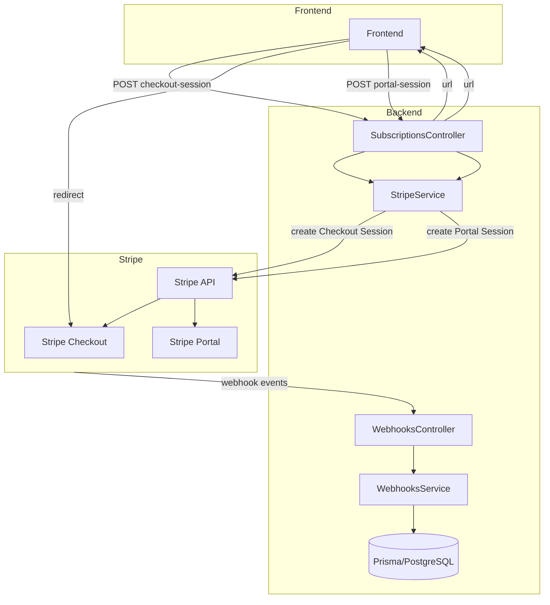

# Plano: Fluxo de Pagamento de Assinatura via Stripe

## Contexto Atual

O backend usa **NestJS 10** com **Prisma** e PostgreSQL. Já existe:

- Módulo de assinaturas (`[subscriptions.controller.ts](src/modules/subscriptions/subscriptions.controller.ts)`) com `subscribe`, `cancel`, `renew`, `getSubscription`
- Modelo `Subscription` sem vínculo com Stripe
- Modelo `User` sem `stripeCustomerId`
- Auth via JWT com `@ActiveUserId()` e rotas públicas via `@IsPublic()`

---

## 1. Alterações no Schema (Prisma)

**Arquivo:** `[prisma/schema.prisma](prisma/schema.prisma)`

- **User:** adicionar `stripeCustomerId String? @unique @map("stripe_customer_id")`
- **Subscription:** adicionar `stripeSubscriptionId String? @unique @map("stripe_subscription_id")`

Depois: `npx prisma migrate dev --name add_stripe_ids`

---

## 2. Dependência e Variáveis de Ambiente

- **package.json:** adicionar `stripe` (versão estável atual)
- **constant-keys.ts:** adicionar `stripeSecretKey`, `stripeWebhookSecret`, `stripePriceId`
- **.env.example:** documentar `STRIPE_SECRET_KEY`, `STRIPE_WEBHOOK_SECRET`, `STRIPE_PRICE_ID`

---

## 3. StripeService

**Novo arquivo:** `src/modules/subscriptions/services/stripe.service.ts`

Responsabilidades:

- Inicializar cliente Stripe com `STRIPE_SECRET_KEY`
- `getOrCreateStripeCustomerId(userId, email)` — busca em User ou cria via Stripe API e persiste
- `createCheckoutSession(userId, successUrl, cancelUrl)` — cria Checkout Session com `mode: "subscription"`, `line_items` com `STRIPE_PRICE_ID`, `client_reference_id: userId`
- `createPortalSession(stripeCustomerId, returnUrl)` — cria Billing Portal Session

Dependências: `UsersRepository`, `Stripe` SDK.

---

## 4. Endpoints no SubscriptionsController

**Arquivo:** `[src/modules/subscriptions/subscriptions.controller.ts](src/modules/subscriptions/subscriptions.controller.ts)`

| Rota                              | Método | Auth | Request                     | Response  |
| --------------------------------- | ------ | ---- | --------------------------- | --------- |
| `/subscriptions/checkout-session` | POST   | JWT  | `{ successUrl, cancelUrl }` | `{ url }` |
| `/subscriptions/portal-session`   | POST   | JWT  | `{ returnUrl }`             | `{ url }` |

**DTOs:** `CreateCheckoutSessionDto`, `CreatePortalSessionDto` com validação `@IsUrl()`.

**Lógica:**

- `checkout-session`: obter `userId` via `@ActiveUserId()`, chamar `stripeService.createCheckoutSession`, retornar `{ url }`
- `portal-session`: obter `userId`, buscar `stripeCustomerId` do usuário (ou assinatura), chamar `stripeService.createPortalSession`, retornar `{ url }`

---

## 5. Webhooks Stripe

### 5.1 Configuração do Raw Body

**Arquivo:** `[src/main.ts](src/main.ts)`

```ts
const app = await NestFactory.create(AppModule, { cors: true, rawBody: true });
```

O Stripe exige o body bruto para validar a assinatura com `constructEvent`.

### 5.2 Módulo e Controller de Webhooks

**Novo módulo:** `src/modules/webhooks/`

- **webhooks.controller.ts:** `POST /webhooks/stripe`
  - Decorator `@IsPublic()` (sem JWT)
  - Usar `@Req() request: RawBodyRequest<Request>` para acessar `request.rawBody`
  - Validar com `stripe.webhooks.constructEvent(rawBody, signature, STRIPE_WEBHOOK_SECRET)`
  - Disparar handler conforme `event.type`
- **webhooks.service.ts:** handlers por evento:
  - `checkout.session.completed` → criar/ativar assinatura no DB (userId via `client_reference_id`, `stripeSubscriptionId` e dados do subscription)
  - `customer.subscription.updated` → atualizar `isActive`, `nextRenewalAt`, `cancelRequestedAt` (via `cancel_at_period_end`)
  - `customer.subscription.deleted` → marcar assinatura como cancelada (`isActive: false`, `cancelRequestedAt`)
- **webhooks.module.ts:** importar `DatabaseModule` (ou repositórios necessários), `NotificationsModule` (para `PAYMENT_CONFIRMED`)

### 5.3 Mapeamento Stripe → DB

| Evento Stripe                   | Ação no DB                                                                                                                                              |
| ------------------------------- | ------------------------------------------------------------------------------------------------------------------------------------------------------- |
| `checkout.session.completed`    | Criar `Subscription` com `stripeSubscriptionId`, `value` do Price, `startDate`, `nextRenewalAt`; atualizar `User.stripeCustomerId` se ainda não existir |
| `customer.subscription.updated` | Atualizar `Subscription` por `stripeSubscriptionId`: `nextRenewalAt`, `cancelRequestedAt` (se `cancel_at_period_end`), `isActive` conforme status       |
| `customer.subscription.deleted` | Atualizar `Subscription` por `stripeSubscriptionId`: `isActive: false`, `cancelRequestedAt`                                                             |

---

## 6. Fluxo de Dados (Resumo)



---

## 7. Integração com Fluxo Existente

- O endpoint `POST /subscriptions` (criar assinatura manual) pode permanecer para cenários internos/trial, ou ser descontinuado em favor do fluxo Stripe.
- `cancel` e `renew` atuais operam direto no DB; com Stripe, o cancelamento/reativação passa pelo Portal. Os webhooks mantêm o DB sincronizado.
- `getSubscription` continua retornando a assinatura do usuário; o DTO pode ser estendido para incluir `stripeSubscriptionId` se necessário no front.

---

## 8. Checklist de Implementação

1. Schema Prisma + migration
2. Instalar `stripe` e configurar constant-keys + .env.example
3. Criar StripeService
4. DTOs e endpoints checkout-session e portal-session
5. Habilitar `rawBody: true` em main.ts
6. Criar WebhooksModule, Controller e Service
7. Registrar WebhooksModule em AppModule
8. Testar com Stripe CLI (`stripe listen --forward-to localhost:3000/webhooks/stripe`)
